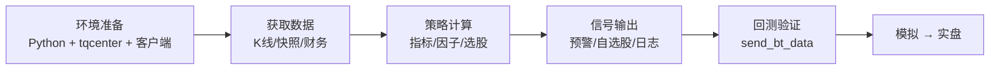

# 通达信量化平台（TdxQuant）入门教程+VCP选股策略

<aside>
🐢

**TdxQuant** 是通达信官方推出的 Python 量化投研框架，通过 API 接口连接通达信客户端，获取行情、财务、板块等数据，并支持策略回测与实盘执行。本教程帮助你从零搭建环境、跑通第一个策略。

</aside>

[TdxQuant 官方文档](https://help.tdx.com.cn/quant/)

---

## 一、环境准备

### 1. 安装 Python

- 支持 **64 位 Python 3.7 – 3.14**，官方建议 **3.13**
- 下载地址：[python.org](http://python.org)
- 安装时勾选 **Add Python to PATH**

### 2. 安装 tqcenter 包

```bash
pip install tqcenter
```

> 如果网络较慢，可加清华镜像：`pip install tqcenter -i https://pypi.tuna.tsinghua.edu.cn/simple`
> 

### 3. 安装并启动通达信客户端

- 需使用支持 **TQ 策略功能**的版本（金融终端 / 专业研究版）
- 登录后，在客户端内下载所需的**盘后数据**（K 线、专业财务等）
- **策略运行前必须保持客户端处于登录状态**

---

## 二、核心概念速览

| **概念** | **说明** |
| --- | --- |
| `tq.initialize(__file__)` | 所有策略的**第一行**，建立与客户端的连接 |
| 股票代码格式 | 6 位数字 + 市场后缀，如 `600519.SH`、`000001.SZ` |
| 时间格式 | `YYYYMMDD` 或 `YYYYMMDDHHMMSS` |
| K 线周期 | `1d` 日线 / `1w` 周线 / `1m` 月线 / `5m` `15m` `30m` `60m` 分钟线 |
| 复权类型 | `none` 不复权 / `front` 前复权 / `back` 后复权 |
| `tq.close()` | 策略退出前调用，断开连接，确保策略管理器状态正确 |

---

## 三、Hello TdxQuant — 第一个策略

新建 `hello_tdx.py`，获取贵州茅台最近 5 根日 K 线：

```python
from tqcenter import tq

# 1. 初始化连接
tq.initialize(__file__)

# 2. 获取 K 线数据
df = tq.get_market_data(
    field_list=[],               # 空 = 返回全部字段
    stock_list=['600519.SH'],    # 贵州茅台
    start_time='',
    end_time='',
    count=5,                     # 最近 5 根
    dividend_type='front',       # 前复权
    period='1d',                 # 日线
    fill_data=False
)

print(df)

# 3. 断开连接
tq.close()
```

运行：

```bash
python hello_tdx.py
```

> **注意**：首次获取 K 线会触发客户端刷新数据，可能需要等待几秒。
> 

---

## 四、常用 API 分类速查

### 4.1 行情数据

```python
# 获取实时快照（最新报价/买卖盘等）
snapshot = tq.get_market_snapshot(stock_code='600519.SH', field_list=[])
print(snapshot)
```

```python
# 订阅实时行情推送（最多 100 只）
import json

def on_update(data_str):
    data = json.loads(data_str)
    code = data.get('Code')
    report = tq.get_market_snapshot(code)
    print(f"[{code}] 最新快照：", report)

tq.subscribe_hq(stock_list=['600519.SH', '000001.SZ'], callback=on_update)
```

### 4.2 财务数据

```python
# 基础财务（不需要下载专业财务数据）
info = tq.get_stock_info(stock_code='600519.SH', field_list=[])
print(info)
```

```python
# 专业财务（需先在客户端下载专业财务数据）
fd = tq.get_financial_data(
    stock_list=['600519.SH'],
    field_list=['Fn193', 'Fn194', 'Fn195'],  # 营收/净利等
    start_time='20250101',
    end_time='',
    report_type='report_time'  # 按截止日期
)
print(fd)
```

### 4.3 板块与成份股

```python
# 获取全部 A 股代码
all_stocks = tq.get_stock_list('5')

# 获取沪深 300 成份股
hs300 = tq.get_stock_list('23')

# 获取某板块（如"钛金属"）成份股
block = tq.get_stock_list_in_sector('钛金属', list_type=1)
```

> `get_stock_list` 参数速查：`5`=全部A股、`23`=沪深300、`24`=中证500、`28`=中证A500、`31`=ETF基金、`51`=创业板、`52`=科创板
> 

### 4.4 调用通达信指标公式

```python
# 先设置股票和K线范围
tq.formula_set_data_info(
    stock_code='600519.SH',
    stock_period='1d',
    count=60,
    dividend_type=1
)

# 调用 MACD 指标
macd = tq.formula_zb(formula_name='MACD', formula_arg='12,26,9', xsflag=6)
print(macd)

# 调用条件选股公式
xg = tq.formula_xg(formula_name='UPN', formula_arg='3')
print(xg)
```

### 4.5 自选股与自定义板块

```python
# 添加股票到自选股，并在客户端弹窗显示
tq.send_user_block(
    block_code='ZXG',
    stocks=['600519.SH', '000858.SZ'],
    show=True
)

# 创建自定义板块
tq.create_sector(block_code='MYBK', block_name='我的策略池')

# 向自定义板块添加股票
tq.send_user_block(block_code='MYBK', stocks=['600519.SH'])
```

---

## 五、实战示例：批量计算 MACD 并筛选金叉

```python
from tqcenter import tq

tq.initialize(__file__)

# 批量对沪深300成份股计算 MACD，取最近 1 根
result = tq.formula_process_mul_zb(
    formula_name='MACD',
    formula_arg='12,26,9',
    retrun_count=1,        # 只取最后一根
    return_date=True,
    stock_list=tq.get_stock_list('23'),  # 沪深300
    stock_period='1d',
    count=60,              # 用 60 根 K 线计算
    dividend_type=1        # 前复权
)

# 筛选 MACD 柱（第3个输出）> 0 的标的
for code, values in result.items():
    if values and len(values) > 0:
        last = values[-1]
        # MACD 公式输出: DIF, DEA, MACD柱
        if len(last) >= 3:
            macd_bar = last[2] if isinstance(last[2], (int, float)) else 0
            if macd_bar > 0:
                print(f"✅ {code}  MACD柱={macd_bar:.4f}")

tq.close()
```

---

## 六、发送预警信号到客户端

```python
from tqcenter import tq

tq.initialize(__file__)

tq.send_warn(
    stock_list=['600519.SH'],
    time_list=['20260310100000'],
    price_list=['1800.00'],
    close_list=['1795.50'],
    volum_list=['5000'],
    bs_flag_list=['0'],         # 0=买 1=卖 2=未知
    warn_type_list=['0'],       # 0=常规预警
    reason_list=['MACD金叉信号触发'],
    count=1
)

print("预警已发送至客户端")
tq.close()
```

---

## 七、策略开发流程总结



---

## 八、常见问题

- **运行报错 "连接失败" 怎么办？**
    
    确保通达信客户端已启动并登录，且使用的是支持 TQ 策略的版本（金融终端 / 专业研究版）。
    
- **get_market_data 返回空数据？**
    
    需要先在客户端中下载对应品种的**盘后数据**。首次调用会触发客户端刷新，耐心等待即可。
    
- **策略管理器显示"运行中"但实际已退出？**
    
    说明策略退出前未调用 `tq.close()`。在策略管理器中删除该策略，然后在代码结尾加上 `tq.close()` 即可。
    
- **如何获取分钟级 K 线？**
    
    将 `period` 参数改为 `'5m'`、`'15m'`、`'30m'` 或 `'60m'`，同时确保客户端已下载对应周期的盘后数据。
    

---

## 九、实战示例：Stage 2 + VCP 串联选股策略

<aside>
🎯

**完整的 Minervini 选股流程**：先用 **Stage 2 趋势模板** 从全 A 股筛出处于上升趋势的候选池，再用 **VCP 波动收缩** 找到即将突破的精确买点，最后可选叠加 **营收财务筛选** 确保基本面支撑。

</aside>


### Stage 2 趋势模板条件（第一层）

1. **均线多头排列** — Price > MA50 > MA150 > MA200
2. **MA200 持续上升** — 近 20 日 MA200 每天都高于前一天
3. **接近高点** — 距 52 周低点涨幅 ≥ 30%，距 52 周高点回撤 ≤ 25%
4. **偏离度可控（①）** — 当前价距 MA50 涨幅 ≤ 25%，过滤过度延伸的追高暴涨股

### VCP 波动收缩条件（第二层）

1. **振幅递减** — 60/40/20/10 日窗口振幅至少 3 次递减
2. **缩量确认** — 5 日均量 < 50 日均量 × 80%
3. **末窗收敛（②）** — 最后一个收缩窗口（10 日）振幅 ≤ 15%，剔除仍在剧烈波动的标的

### 营收筛选（第三层，可选）

1. **连续两季营收同比增速 > 5%** — 需下载专业财务数据

### 完整代码

```python
import numpy as np
import pandas as pd
from tqcenter import tq

tq.initialize(__file__)

# ========== 参数设置 ==========
UNIVERSE = tq.get_stock_list('5')           # 全部 A 股
KLINE_REQUEST = 250                          # 请求 250 根日 K
MIN_BARS = 60                                # 最低接受 60 根
CONTRACTION_PERIODS = [60, 40, 20, 10]       # VCP 波动收缩窗口
MIN_CONTRACTIONS = 3                         # 至少 3 次振幅递减
EXT_MAX = 0.25                               # ① 偏离度上限：当前价距 MA50 涨幅 ≤ 25%
LAST_RANGE_MAX = 15                          # ② 最后收缩窗口振幅上限(%)，> 此值视为未收敛
ENABLE_FINANCE = False                       # 设为 True 启用营收筛选（需下载专业财务）

# ============================================================
# get_market_data 返回 dict of DataFrames：
#   'Close' / 'High' / 'Low' / 'Open' / 'Volume' / 'Amount'
# 字段名首字母大写，成交量是 Volume
# ============================================================

def extract_series(data, field, code):
    """从 get_market_data 返回的 dict 中提取某只股票的一列数据"""
    df = data[field]
    if code in df.columns:
        return df[code].dropna().values.astype(float)
    if len(df.columns) == 1:
        return df.iloc[:, 0].dropna().values.astype(float)
    return np.array([])

# ========== 诊断计数器 ==========
cnt = {
    'total': 0, 'data_ok': 0,
    'pass_stage2': 0, 'pass_high': 0, 'pass_ext': 0,
    'pass_vcp': 0, 'pass_tight': 0, 'pass_vol': 0, 'pass_finance': 0
}
results = []

for code in UNIVERSE:
    try:
        cnt['total'] += 1
        data = tq.get_market_data(
            field_list=[], stock_list=[code],
            start_time='', end_time='',
            count=KLINE_REQUEST, dividend_type='front',
            period='1d', fill_data=False
        )

        if data is None or not isinstance(data, dict):
            continue
        if 'Close' not in data:
            continue

        close = extract_series(data, 'Close', code)
        high  = extract_series(data, 'High', code)
        low   = extract_series(data, 'Low', code)
        vol   = extract_series(data, 'Volume', code)

        n = len(close)
        if n < MIN_BARS:
            continue
        cnt['data_ok'] += 1

        cur_price = close[-1]

        # ============================================================
        # 第一层：Stage 2 趋势模板
        # ============================================================
        ma50  = np.mean(close[-min(50, n):])
        ma150 = np.mean(close[-min(150, n):])
        ma200 = np.mean(close[-min(200, n):])

        # C1: 股价 > MA50 > MA150 > MA200（完整多头排列）
        if not (cur_price > ma50 > ma150 > ma200):
            continue

        # C2: MA200 近 20 日持续上升
        if n >= 220:
            ma200_rising = all(
                np.mean(close[-(200+i):-(i) or None]) >= np.mean(close[-(201+i):-(i+1) or None])
                for i in range(20)
            )
        else:
            # 数据不足时简化判断：MA200 > 20天前的 MA200
            if n >= 40:
                ma200_prev = np.mean(close[:-20][:min(200, n-20)])
            else:
                ma200_prev = ma200
            ma200_rising = (ma200 >= ma200_prev)

        if not ma200_rising:
            continue
        cnt['pass_stage2'] += 1

        # ============================================================
        # Stage 2 补充：接近高点
        # ============================================================
        lookback = min(250, n)
        high_52w = np.max(high[-lookback:])
        low_52w  = np.min(low[-lookback:])

        # 距 52 周高点回撤 ≤ 25%
        if cur_price < high_52w * 0.75:
            continue
        # 距 52 周低点涨幅 ≥ 30%
        if low_52w > 0 and (cur_price - low_52w) / low_52w < 0.30:
            continue
        cnt['pass_high'] += 1

        # ============================================================
        # ① 偏离度过滤：当前价距 MA50 涨幅 ≤ EXT_MAX
        #    只买贴近均线的收缩末端，过滤"过度延伸/追高"的暴涨股
        # ============================================================
        if ma50 > 0 and (cur_price - ma50) / ma50 > EXT_MAX:
            continue
        cnt['pass_ext'] += 1

        # ============================================================
        # 第二层：VCP 波动收缩
        # ============================================================
        ranges = []
        for w in CONTRACTION_PERIODS:
            if w > n:
                continue
            wh = np.max(high[-w:])
            wl = np.min(low[-w:])
            rng = (wh - wl) / wl * 100 if wl > 0 else 0
            ranges.append(rng)

        if len(ranges) >= 2:
            contractions = sum(
                1 for i in range(len(ranges) - 1)
                if ranges[i] > ranges[i + 1]
            )
        else:
            contractions = 0

        if contractions < MIN_CONTRACTIONS:
            continue
        cnt['pass_vcp'] += 1

        # ============================================================
        # ② 收敛度过滤：最后一个收缩窗口振幅 ≤ LAST_RANGE_MAX
        #    最近波动仍剧烈（如抛物线/妖股）则剔除，确保收缩到位
        # ============================================================
        if ranges and ranges[-1] > LAST_RANGE_MAX:
            continue
        cnt['pass_tight'] += 1

        # ============================================================
        # VCP 补充：缩量确认
        # ============================================================
        vol_5  = np.mean(vol[-min(5, n):])
        vol_50 = np.mean(vol[-min(50, n):])
        if vol_50 > 0 and vol_5 > vol_50 * 0.8:
            continue
        cnt['pass_vol'] += 1

        # ============================================================
        # 第三层（可选）：营收财务筛选
        # ============================================================
        if ENABLE_FINANCE:
            try:
                fd = tq.get_financial_data(
                    stock_list=[code],
                    field_list=['Fn193'],    # 营业收入
                    start_time='', end_time='',
                    report_type='report_time'
                )
                if fd is None or code not in fd or len(fd[code]) < 2:
                    continue
                # 取最近两期报告的营收
                reports = fd[code]
                rev_latest = reports[-1] if isinstance(reports[-1], (int, float)) else 0
                rev_prev   = reports[-2] if isinstance(reports[-2], (int, float)) else 0
                # 简化判断：两期营收都 > 0 且最近一期 > 上一期 * 1.05
                if not (rev_latest > 0 and rev_prev > 0 and rev_latest > rev_prev * 1.05):
                    continue
            except Exception:
                continue  # 财务数据获取失败则跳过
        cnt['pass_finance'] += 1

        # ✅ 通过全部筛选
        results.append({
            'code': code,
            'price': round(cur_price, 2),
            'ma50': round(ma50, 2),
            'ma150': round(ma150, 2),
            'ma200': round(ma200, 2),
            'pct_from_high': round((1 - cur_price / high_52w) * 100, 1),
            'vol_ratio': round(vol_5 / vol_50, 2) if vol_50 > 0 else 0,
            'contractions': contractions,
            'bars': n
        })

    except Exception as e:
        if cnt['total'] <= 5:
            print(f"[ERR] {code}: {e}")
        continue

# ========== 诊断输出 ==========
print("\n===== 筛选漏斗 =====")
print(f"总股票数:         {cnt['total']}")
print(f"数据充足(>={MIN_BARS}):   {cnt['data_ok']}")
print(f"[Stage2] 趋势模板: {cnt['pass_stage2']}")
print(f"[Stage2] 接近高点: {cnt['pass_high']}")
print(f"[①偏离度] 贴近MA50: {cnt['pass_ext']}")
print(f"[VCP]    波动收缩: {cnt['pass_vcp']}")
print(f"[②收敛度] 末窗收敛: {cnt['pass_tight']}")
print(f"[VCP]    缩量确认: {cnt['pass_vol']}")
print(f"[财务]   营收筛选: {cnt['pass_finance']}  ({'已启用' if ENABLE_FINANCE else '未启用'})")

# ========== 结果输出 ==========
if results:
    df_result = pd.DataFrame(results)
    df_result.sort_values('pct_from_high', ascending=True, inplace=True)
    print(f"\n===== Stage2 + VCP 选股结果：共 {len(df_result)} 只 =====")
    print(df_result.to_string(index=False))

    tq.create_sector(block_code='S2VCP', block_name='Stage2+VCP')
    tq.send_user_block(
        block_code='S2VCP',
        stocks=[r['code'] for r in results],
        show=True
    )
    print("\n结果已推送至客户端【Stage2+VCP】板块")
else:
    print("\n未找到符合条件的标的")
    print("提示：观察上方漏斗，在哪一步骤数量骤降，可针对性放宽该条件")

tq.close()
```

### 参数调优建议

| **参数** | **默认值** | **层级** | **说明** |
| --- | --- | --- | --- |
| MA 多头排列 | `P > MA50 > MA150 > MA200` | Stage 2 | 可去掉 MA50 要求来放宽 |
| MA200 上升 | 近 20 日持续上升 | Stage 2 | 改为“不下降”可放宽 |
| 距高点回撤 | ≤ 25% | Stage 2 | 改为 0.65 可放宽至 35% |
| `EXT_MAX`（①偏离度） | `0.25` | Stage 2 | 当前价距 MA50 上限；强趋势市可放宽至 0.30 |
| `CONTRACTION_PERIODS` | `[60, 40, 20, 10]` | VCP | 窗口越多检测越严格 |
| `MIN_CONTRACTIONS` | `3` | VCP | 设为 2 可放宽 |
| `LAST_RANGE_MAX`（②收敛度） | `15` | VCP | 最后窗口振幅上限(%)；调小更严，过滤抛物线 |
| 缩量比例 | `vol_5 < vol_50 * 0.8` | VCP | 改为 0.7 更严，1.0 更宽 |
| `ENABLE_FINANCE` | `False` | 财务 | 设为 True 启用营收筛选 |

---

## 十、附录：原始示例代码

- **tq 官方完整示例（点击展开）**
    
    ```python
    import numpy as np 
    import pandas as pd 
    from tqcenter import tq
    import time
    import json
    
    """
        这里是tq的简单使用示例
        使用时请确保已经启动通达信客户端并登录
        取消对应注释即可运行对应功能
    """
    
    """
        参数设置
    """
    codes = ["688318.SH"]
    startime = "20250620"
    endtime = "20250801"
    period = '1d'
    dividend_type='none'
    
    tq.initialize(__file__)
    
    # --- 刷新行情缓存 ---
    # refresh_cache = tq.refresh_cache()
    
    # --- 缓存历史K线 ---
    # refresh_kline = tq.refresh_kline(stock_list=['688318.SH'],period='1d')
    
    # --- 获取K线数据 ---
    # df = tq.get_market_data(
    #         field_list=[],
    #         stock_list=['688318.SH'],
    #         start_time='',
    #         end_time='',
    #         count=1,
    #         dividend_type='none',
    #         period='1d',
    #         fill_data=False
    #     )
    
    # --- 获取分红送配数据 ---
    # divid_factors = tq.get_divid_factors(stock_code='688318.SH', start_time='', end_time='')
    
    # --- 获取市场快照数据 ---
    # market_snapshot = tq.get_market_snapshot(stock_code='688318.SH', field_list=['Buyp'])
    
    # --- 获取可转债基础数据 ---
    # cb_info = tq.get_cb_info(stock_code='123049.SZ', field_list=['CurRate'])
    
    # --- 获取新股申购信息 ---
    # ipo_info = tq.get_ipo_info(ipo_type=2, ipo_date=1)
    
    # --- 获取股票更多数据 ---
    # more_info = tq.get_more_info(stock_code='880544.SH', field_list=['ZTGPNum'])
    
    # --- 获取股本数据 ---
    # gb_info = tq.get_gb_info(stock_code='688318.SH', date_list=['20250101','20250601'], count=2)
    
    # --- 获取基础财务数据 ---
    # fdc = tq.get_stock_info(stock_code='688318.SH', field_list=[])
    
    # --- 专业财务数据 ---
    # fd = tq.get_financial_data(stock_list=['688318.SH'], field_list=['Fn193','Fn194','Fn195','Fn196','Fn197'], start_time='20250101', end_time='', report_type='announce_time')
    
    # --- 获取交易日列表 ---
    # trade_dates = tq.get_trading_dates(market='SH', start_time='20220101', end_time='', count=10)
    
    # --- 获取股票代码 ---
    # stock_list = tq.get_stock_list('31', list_type=1)
    
    # --- 获取板块成分股 ---
    # block_stocks = tq.get_stock_list_in_sector('880081.SH')
    
    # --- 调用通达信公式 ---
    # formula_zb = tq.formula_zb(formula_name='MACD', formula_arg='12,26,9', xsflag=6)
    
    # tq.close()
    ```